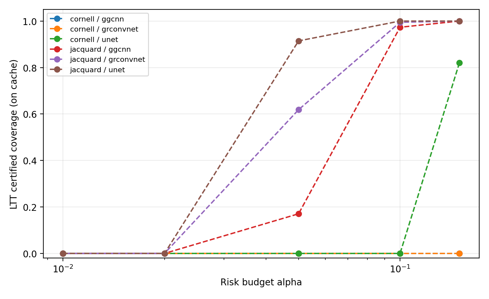
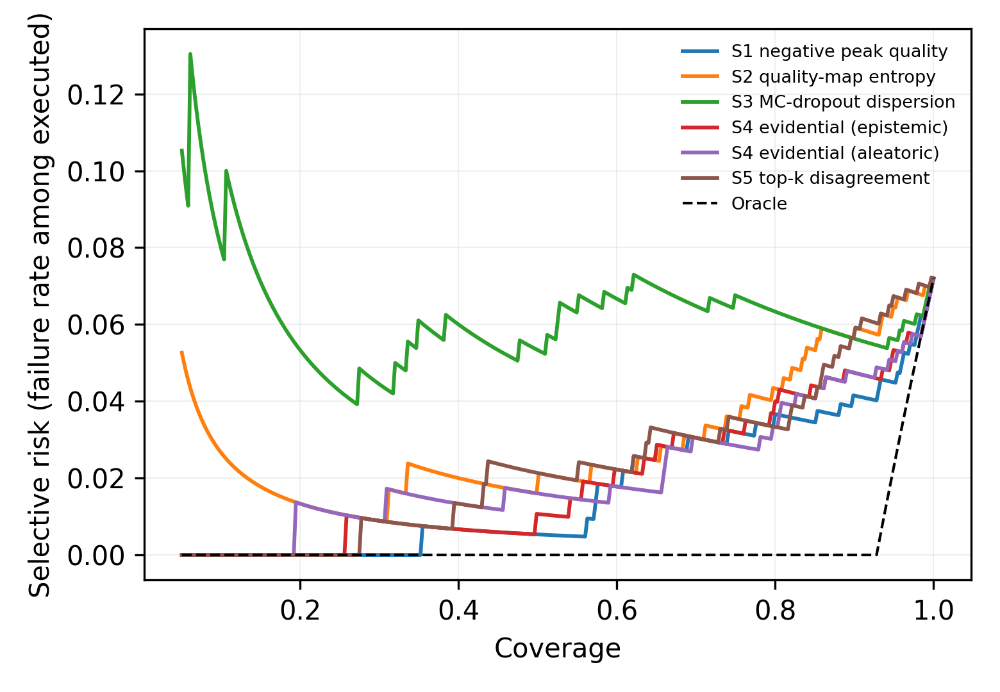
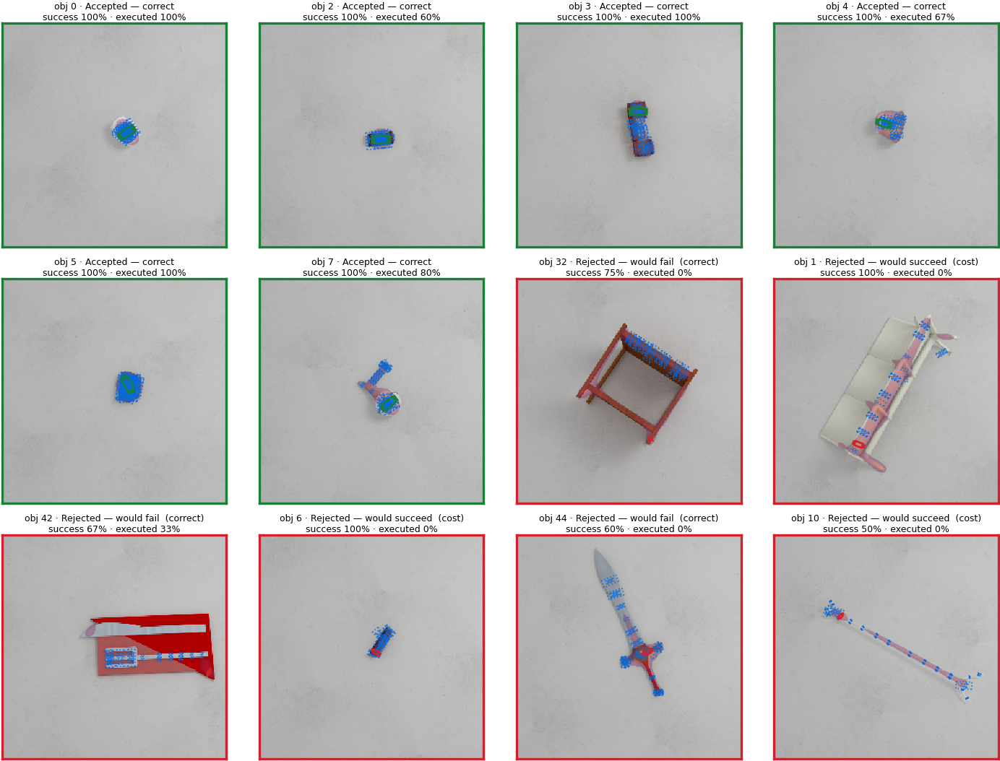

# FISAT 2026 | Selective Robotic Grasp Detection

**Distribution-Free Rejection Rules and Risk-Coverage Analysis for Selective Robotic Grasp Detection**  
**Author:** Hang Anh Le — University of Economics – Technology for Industries (UNETI), Vietnam  
**Conference:** EAI FISAT 2026

[**Read the paper (PDF)**](paper/FISAT2026_HangAnhLe.pdf) · [**Source code**](src/) · [**Executed Colab notebooks**](notebooks/executed/) · [**Results & figures**](results/) · [**Reproducibility audit**](docs/REPRODUCIBILITY_AUDIT.md)

## Overview

A grasp detector is often required to predict a grasp even for difficult RGB-D scenes. This research studies **selective grasp detection**, which permits the system to **abstain** when its uncertainty score is too high. For a frozen detector with uncertainty score `s` (larger means less confident), the rule executes a grasp when `s ≤ τ` and abstains otherwise. A Learn-then-Test (LTT) procedure calibrates a threshold against a specified **conditional failure-risk budget** `α` at confidence `1 − δ`, subject to its statistical assumptions.

The evaluation uses **Cornell** and **Jacquard V2**, three detector architectures (**GR-ConvNet, GG-CNN, U-Net**), and multiple uncertainty scores. The reported outcomes use the **offline rectangle metric**; they are *not* physical-robot grasp success or safety certificates.

## Results at a glance

### Detector performance and uncertainty ranking

Values below reproduce the rounded results reported in **Table 1** of the supplied FISAT manuscript. **Lower AURC is better**.

| Dataset | Detector | Grasp success | Best uncertainty score by AURC | AURC ↓ | LTT certified at α = 0.10? | Strictest certified α |
|:--|:--|--:|:--|--:|:--:|:--:|
| Cornell | GR-ConvNet | 68.7% | S3: MC-dropout | 0.195 | No | None |
| Cornell | GG-CNN | 63.0% | S3: MC-dropout | 0.199 | No | None |
| Cornell | U-Net | 82.3% | S3: MC-dropout | 0.075 | No | 0.15 |
| Jacquard | GR-ConvNet | 92.8% | S1: peak confidence | **0.016** | Yes | 0.05 |
| Jacquard | GG-CNN | 92.0% | S1: peak confidence | 0.021 | Yes | 0.05 |
| Jacquard | U-Net | 96.0% | S5: top-k disagreement | **0.011** | Yes | 0.05 |

*Evaluation sizes: Cornell N = 300 and Jacquard N = 375. The best AURC score is selected retrospectively; it should not be treated as a universally optimal deployment choice.*

### Figure 1 — Certified grasp coverage versus risk budget



*Diagnostic plot regenerated from the supplied cached score arrays using `scripts/rebuild_figures.py`. It illustrates the coverage–risk-budget behavior across six settings; it is not claimed to be the exact source image embedded in the paper PDF. Zero on this plot denotes no certified non-empty operating threshold, **not** a successful 0%-risk deployment.*

### Figure 2 — Risk–coverage curves on Jacquard



*Supplied Jacquard figure: lower selective failure risk at a given coverage is preferable. S1/S2/S3/S4/S5 indicate different uncertainty scores; the oracle is a retrospective reference rather than a deployable model.*

### Figure 3 — Example accepted and rejected grasps



*Supplied Jacquard visualization: green borders represent executed grasps and red borders represent abstentions. A rejected grasp may have been successful (over-rejection), illustrating the trade-off between risk and coverage.*

### Calibration verification: do not confuse hold rate and coverage

In the **Jacquard / GR-ConvNet** experiment, 300 random calibration/evaluation re-splits yielded the following empirical verification results (manuscript Table 2):

| Risk budget α | Certifiable | Empirical hold rate across 300 splits | Mean evaluated executed risk |
|--:|:--:|--:|--:|
| 0.15 | Yes | 1.000 | 0.072 |
| 0.10 | Yes | 1.000 | 0.054 |
| 0.05 | Yes | **0.990** | **0.012** |
| 0.02 | No | — | — |
| 0.01 | No | — | — |

At **α = 0.05**, the example certified operating point in **Table 3** executed **232/375 grasps (61.9% coverage)**, with **227 successes and 5 failures**. Thus, **99.0% hold rate** is the fraction of re-splits meeting the risk budget, whereas **61.9% grasp coverage** is the fraction of accepted grasps at that operating point. They are not interchangeable.

The Hoeffding calibration-size expression in the manuscript is a **conservative sufficient reference**, not a universal minimum sample requirement. Actual certification uses the stated Hoeffding–Bentkus testing procedure. See the paper for the precise context and assumptions.

## Repository contents

| Directory | Description |
|:--|:--|
| [`paper/`](paper/) | 12-page submitted FISAT manuscript |
| [`src/`](src/) | Dataset handlers, model definitions, uncertainty scoring, calibration and evaluation code |
| [`configs/`](configs/) | Six model/dataset YAML configurations |
| [`notebooks/executed/`](notebooks/executed/) | Six executed Colab notebooks with saved output |
| [`notebooks/templates/`](notebooks/templates/) | Clean/source notebook templates |
| [`data/scores/`](data/scores/) | Six score-cache `.npz` artifacts, 3 detectors × 2 datasets |
| [`checkpoints/`](checkpoints/) | Eight supplied `.pt` files (best/last for deterministic and evidential runs, on Cornell and Jacquard), with training histories |
| [`results/jacquard/`](results/jacquard/) | Supplied Jacquard visualizations |
| [`results/summary/`](results/summary/) | Cross-checked Table 1 metrics and diagnostic coverage plot |
| [`results/cornell_legacy/`](results/cornell_legacy/) | Historical Cornell figures and tables **not identical to final manuscript results** |
| [`scripts/`](scripts/) | Offline numerical consistency checks and figure generation |
| [`docs/`](docs/) | Provenance, completeness and reproducibility assessment |

## Check reported metrics without retraining

A local environment with Python and the project dependencies is sufficient to check selected results from the provided score caches. This is optional; **no retraining is required to browse the results in this repository**.

```bash
python -m pip install -r requirements.txt
python scripts/verify_paper_metrics.py
python scripts/verify_paper_metrics.py --full
python scripts/rebuild_figures.py
```

The `--full` command includes the Jacquard 300-split check. For an exploratory single-cache analysis:

```bash
cd src
python selective_grasp.py --scores ../data/scores/jacquard_grconvnet.npz --alpha 0.05 --delta 0.10 --out ../results/local_analysis
```

> **Important:** The exploratory `src/selective_grasp.py` output tables belong to an earlier analysis format; do **not** label them as Tables 1–3 from the final manuscript. For paper consistency checks, prefer `scripts/verify_paper_metrics.py`.

## Training from scratch (optional)

The raw Cornell and Jacquard image datasets are **not** included. To train new models, obtain these datasets separately, set `data.root` in the corresponding YAML config, and run from `src/` (e.g., `python train.py --config ../configs/configs_cornell.yaml --method deterministic`). Historical Colab Drive paths also need updating for a new environment.

## Scope, missing assets, and limitations

- The provided `.npz` caches support selected numerical verification, but are not a substitute for independent re-training or external validation.
- **Eight `.pt` checkpoint files** are included for the supplied GR-ConvNet/deterministic and evidential runs; **GG-CNN and U-Net experiment checkpoints are not included**.
- No raw datasets, exact original train/validation/test file manifests, or pinned full training-environment lockfile are provided.
- Calibration guarantees depend on the stated assumptions, including exchangeability and correct score/threshold selection protocols; performance under distribution shift or sequential bin picking was **not validated**.
- The study does **not** test physical robot grasping, joint-limit feasibility, collision avoidance or rigid-body simulation.

See [`docs/REPRODUCIBILITY_AUDIT.md`](docs/REPRODUCIBILITY_AUDIT.md) for the detailed archive audit and verified calculations.

## Publication and reuse

Before switching this repository to public visibility, verify the conference/publisher's rights regarding redistribution of the manuscript and model weights. No software license has been assigned to this archive.
